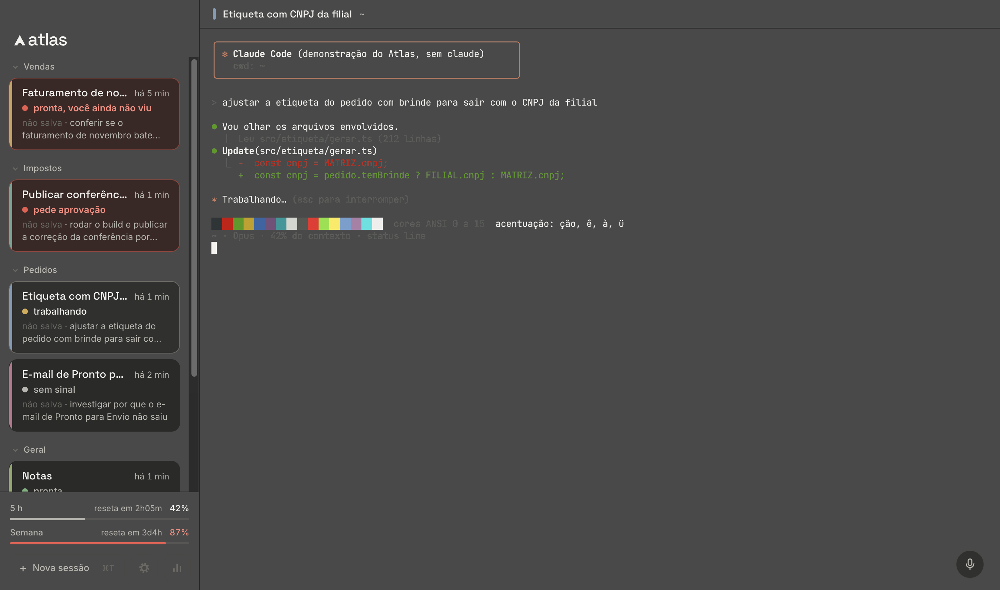

<p align="center">
  <picture>
    <source media="(prefers-color-scheme: dark)" srcset="identidade/logos/svg/atlas-logo-horizontal-giz.svg">
    
  </picture>
</p>

App de Mac que abre várias sessões do [Claude Code](https://claude.com/claude-code) lado a lado. Cada sessão ganha um cartão colorido que mostra o estado dela: trabalhando, pede aprovação, pronta, sem sinal ou encerrada. Os cartões podem ser organizados em grupos, e uma chamada curta ao Haiku sugere o grupo de cada sessão nova.



## Requisitos

- Mac com chip Apple (M1 ou mais novo). O app é gerado só para `arm64` e não roda no Windows nem no Linux.
- [Claude Code](https://claude.com/claude-code) instalado e funcionando no Terminal (comando `claude`).
- Node.js 20 ou mais novo e npm.
- Python 3 (`python3`), usado pelos hooks.
- zsh como shell (o padrão do macOS). As sessões são abertas por um zsh de login.

## Instalar

```sh
git clone https://github.com/ttupacheco/atlas-sessoes.git
cd atlas-sessoes
./scripts/criar-certificado.sh   # uma vez só
./atualizar.sh
```

1. `scripts/criar-certificado.sh` cria no Keychain de login uma identidade de assinatura chamada **Atlas Local** (autoassinada, válida por 10 anos). Assinar sempre com ela faz o macOS reconhecer o Atlas como o mesmo app a cada atualização, sem pedir as permissões de novo.
2. `./atualizar.sh` instala as dependências, roda os testes, gera o app, assina, instala em `/Applications/Atlas.app` (o anterior vai para o Lixo), cria um atalho na Mesa, instala os hooks no Claude Code e abre o Atlas.

Para atualizar depois, rode `git pull` e de novo `./atualizar.sh`. Se o Atlas estiver aberto, o script pergunta antes de fechar. Pedido de dentro de uma sessão do próprio Atlas, ele prepara tudo e só troca o app quando você fechar o Atlas com ⌘Q.

## O que a instalação mexe no seu `~/.claude`

O instalador (`hook/instalar.py`) é idempotente e guarda uma cópia com data (`.bak-atlas-AAAA-MM-DD`) antes de alterar um arquivo seu:

- **`settings.json`**: registra o hook `~/.claude/hooks/atlas-estado.py` nos eventos do Claude Code. O comando só chama o Python quando a sessão foi aberta pelo Atlas (variável `ATLAS_SESSAO_ID`); no Terminal comum ele não faz nada.
- **`hooks/avisar.py`**: o aviso do Mac quando uma sessão termina ou pede aprovação. O instalador só cria este arquivo quando ele não existe, ou atualiza uma cópia anterior do Atlas. Um `avisar.py` seu nunca é trocado.
- **`commands/salvar.md`**: veja "Salvar antes de fechar" abaixo.

Os eventos das sessões ficam em `~/.claude/atlas/` (um arquivo por sessão, apagado quando a sessão fecha). As sessões abertas, com nome, título e cor, ficam em `~/Library/Application Support/Atlas/sessoes.json`.

## Salvar antes de fechar

Ao fechar uma sessão, o Atlas pode digitar `/salvar` nela e esperar a resposta terminar. Se você ainda não tem um comando ou skill `/salvar`, o instalador põe uma versão genérica (`comandos/salvar.md`), que grava um resumo da conversa em `~/Documents/Atlas/Sessões/` (ou na pasta de notas que o seu CLAUDE.md indicar). Se você já tem o seu `/salvar`, ele é mantido como está.

## Recursos opcionais

Estes recursos dependem de peças que não vêm no repositório. Sem elas, o Atlas funciona normalmente e só esse recurso fica parado.

- **Barras de uso do plano (5 h e semana).** O Atlas lê `~/.claude/atlas/uso.json`, gravado pela sua status line. O instalador só acrescenta a linha que grava esse arquivo se você tiver uma status line em `~/.claude/statusline-uso.sh` com a linha `input=$(cat)`. Para usar a de exemplo, copie `hook/statusline-exemplo.sh` para `~/.claude/statusline-uso.sh`, aponte o `statusLine` do seu `settings.json` para ela e rode `./atualizar.sh` de novo. Ela usa o [`jq`](https://jqlang.org/).
- **Modo Jarvis.** A chave nas Configurações liga ou desliga a leitura em voz alta das respostas, criando ou apagando o arquivo `~/.claude/jarvis/ligado`. Quem efetivamente lê em voz alta é um hook seu que respeite esse arquivo; ele não vem no repositório.

## Desinstalar

1. Feche o Atlas e apague `/Applications/Atlas.app` e o atalho na Mesa.
2. Hooks: restaure a cópia **mais antiga** de `~/.claude/settings.json.bak-atlas-*` (a de antes da primeira instalação) ou apague no `settings.json` os itens com `atlas-estado.py`.
3. Status line: restaure `~/.claude/statusline-uso.sh.bak-atlas-*` ou apague a linha marcada com `# atlas-uso`.
4. Se quiser, apague `~/.claude/hooks/atlas-estado.py`, `~/.claude/atlas/`, `~/Library/Application Support/Atlas/` e a identidade **Atlas Local** no app Acesso às Chaves.

Depois de desinstalar, não rode `./atualizar.sh`: ele reinstala tudo.

## Desenvolvimento

- `npm start` abre o app sem instalar.
- `npm test` roda os testes do app; `python3 -m unittest discover -s hook` roda os dos hooks.
- `ATLAS_DEMO=1 npm start` abre um modo de demonstração com sessões falsas, sem rodar o Claude Code (ver o começo de `src/demo.js`).

## Licença

[MIT](LICENSE).
